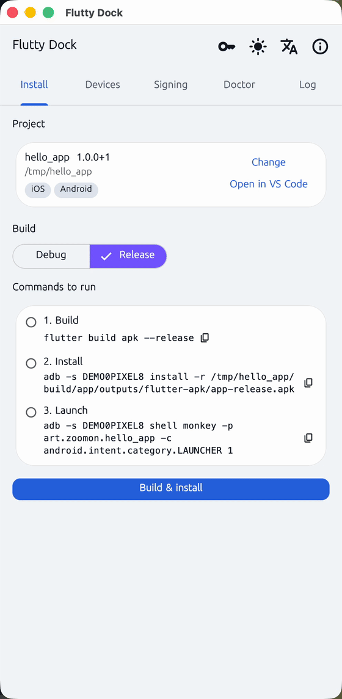
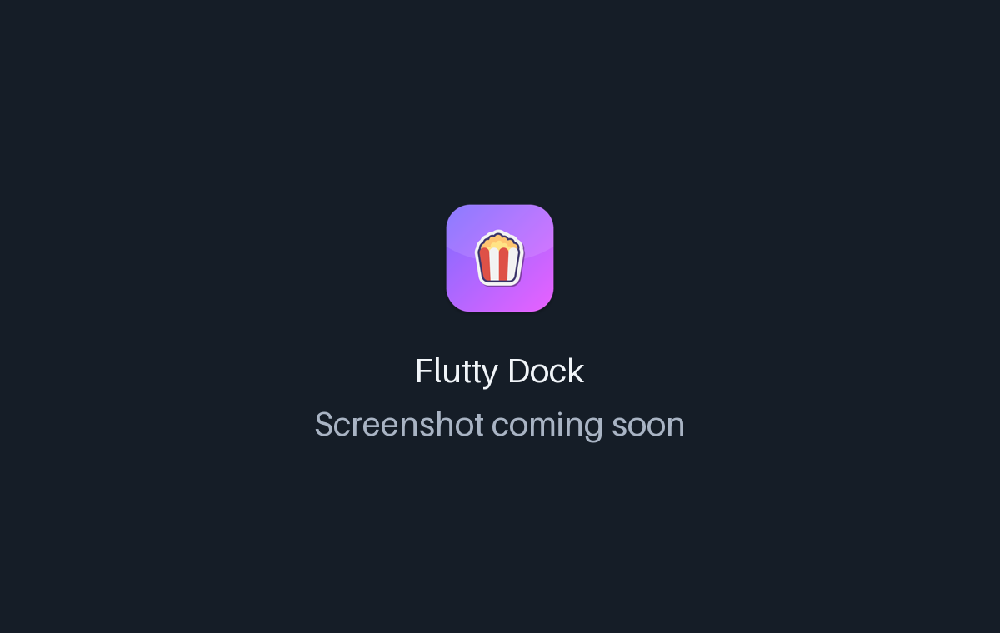
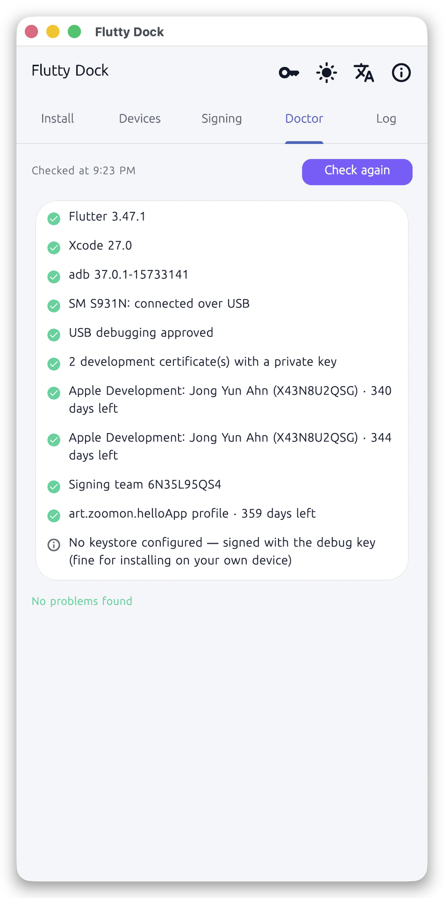

<!-- From jejezz/application-release-templates common/tool/readme @ conventions-v1.
     Generated by tool/readme/init_readme.py — see conventions/readme-guide.md.
     Fill every {{TODO: …}}; tool/readme/check_readme.py fails while any is left. -->

<p align="center">
  
</p>

<h1 align="center">Flutty Dock</h1>

<p align="center">
  A free, open-source <b>desktop companion for putting Flutter apps on real iPhones and Android phones</b> — dock it beside your editor and build and install debug or release over USB with buttons that show the exact command they run.
</p>

<p align="center">
  <a href="https://github.com/jejezz/flutty-dock-flutter/releases/latest"></a>
  <a href="https://github.com/jejezz/flutty-dock-flutter/releases"></a>
  
  
  <a href="LICENSE"></a>
</p>

<p align="center">
  <b>English</b> · <a href="README.ko.md">한국어</a>
</p>

<p align="center">
  
</p>

## Features

- **Buttons that show their command** — every build, install and launch step lists the exact command it runs (`xcodebuild …`, `xcrun devicectl device install app …`, `adb install -r …`), copyable as is, and the command log keeps the output
- **iPhone and Android over USB, debug and release** — release builds are signed with your development certificate and installed straight onto the phone, no TestFlight; debug runs `flutter run` with hot reload and hot restart buttons
- **This computer too, when the project supports it** — if a project already has a `macos/` or `windows/` folder, the desktop app of the OS you're running on appears as "This Mac" / "This PC": debug runs it with hot reload, release builds it and opens the result. Platforms the project doesn't have are never offered
- **Doesn't touch your project** — the signing team is passed as a build argument, never written to `project.pbxproj`, so any Flutter project works as it is
- **One next step, drawn out** — a banner names the one thing blocking you (wireless instead of USB, Developer Mode off, no Team ID …) with numbered steps to fix it; the Doctor checks Flutter, Xcode, adb, certificates and their expiry, provisioning profiles (including the 7-day profile of a free account) and the Android keystore
- **Release secrets (macOS)** — registers the GitHub Actions secrets for macOS signing with `gh secret set`; values go through standard input, are never stored, and never appear in the command log
- **Editor-side** — open the project in VS Code, drop a project folder on the window, and the window keeps its size and position next to your editor
- **Light & dark, English & 한국어** — follows the system, or pick one in the toolbar

<p align="center">
  
  
</p>

## Install

Download from [**Releases**](https://github.com/jejezz/flutty-dock-flutter/releases/latest):

| OS | File |
|---|---|
| macOS 12.0+ | `FluttyDock-<version>-macos-universal.dmg` — open it and drag Flutty Dock to Applications |
| Windows 10/11 (x64) | `FluttyDock-<version>-windows-x64-setup.exe` |

**Windows:** the installer isn't code-signed yet, so SmartScreen says "Windows protected your PC" — choose **More info → Run anyway**.

## How it works

Flutty Dock doesn't reimplement Flutter's tooling. It runs the `flutter`, `xcodebuild`, `xcrun devicectl` and `adb` you already have, with argument lists and no shell, so what you do in the app and what you do in a terminal always agree. The signing team travels as `DEVELOPMENT_TEAM=<id>` on the `xcodebuild` command line for release, and as `FLUTTER_XCODE_DEVELOPMENT_TEAM` for `flutter run` (Flutter forwards `FLUTTER_XCODE_*` variables to `xcodebuild`), which is how the project stays untouched.

## Development

```bash
flutter pub get
flutter run -d macos
```

Installing on an iPhone needs macOS with Xcode and an Apple Developer account signed in to Xcode; on Windows only Android is supported. Android needs `adb` (Android SDK platform-tools) on your `PATH`. The release secrets screen needs the GitHub CLI (`gh`). What was verified on real devices, and the plan, are in [PLAN.md](PLAN.md).

Releasing: `scripts/bump-version.sh patch`, merge, then tag `vX.Y.Z` — CI builds and publishes every platform. Rules: [application-release-templates/conventions](https://github.com/jejezz/application-release-templates/tree/main/conventions).

## Credits

- Font: [SeoulNamsan](https://www.seoul.go.kr/seoul/font.do) (Seoul Metropolitan Government)
- Icons: [Icons8](https://icons8.com)

## License

[MIT](LICENSE) © 2026 Jongyun Ahn
